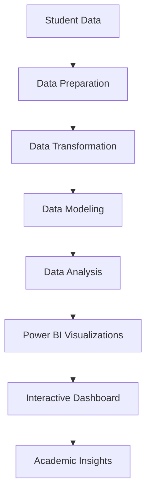

# Student Dashboard Analytics

## Student Overall Performance Dashboard Using Power BI

## Project Overview

Student Dashboard Analytics is a data visualization and analytics project developed using Microsoft Power BI to analyze and monitor student academic performance, attendance, and engagement.

The dashboard aims to transform student-related data into meaningful visual insights that help educators and academic administrators understand performance patterns, monitor academic progress, and identify areas that may require attention.

The project demonstrates the application of data analytics, data visualization, and business intelligence concepts in the education domain.

## Project Objectives

- Analyze student academic performance using interactive visualizations.
- Monitor student attendance and engagement patterns.
- Present important academic information in a centralized dashboard.
- Identify performance trends and areas requiring improvement.
- Support data-driven academic monitoring and decision-making.
- Convert raw educational data into understandable visual insights.

## Key Features

- **Student Performance Analysis:** Visual representation of student academic performance.
- **Attendance Monitoring:** Analysis of student attendance-related information.
- **Engagement Analysis:** Explore student engagement patterns.
- **Interactive Dashboard:** Present information through Power BI visualizations.
- **Data-Driven Insights:** Support the identification of academic trends and patterns.
- **Centralized Reporting:** Provide an organized view of student-related analytics.

## Dashboard Preview

The Power BI dashboard is available in the project repository.

**Power BI File:** `Student Overall Performance Dashboard_Power Bi.pbix`

To explore the dashboard, download the PBIX file and open it using Microsoft Power BI Desktop.

## Technologies Used

| Technology | Purpose |
|---|---|
| Microsoft Power BI | Dashboard development and data visualization |
| Power Query | Data preparation and transformation |
| DAX | Data analysis expressions and calculations |
| Data Visualization | Presenting analytical insights |
| Microsoft Power BI Desktop | Dashboard development environment |

## Dashboard Development Workflow

The project follows a general business intelligence workflow:



## Tools and Platform

- Microsoft Power BI Desktop
- Power Query Editor
- DAX
- GitHub

## Project Structure

```text
Student-Dashboard-Analytics/
│
├── Student Overall Performance Dashboard_Power Bi.pbix
│
└── README.md
```

## How to Run the Project

### Step 1: Clone the Repository

```bash
git clone https://github.com/NelluriVarsha/Student-Dashboard-Analytics.git
```

### Step 2: Navigate to the Project Folder

```bash
cd Student-Dashboard-Analytics
```

### Step 3: Download and Install Power BI Desktop

Download Microsoft Power BI Desktop from:

https://www.microsoft.com/power-platform/products/power-bi/desktop

### Step 4: Open the Dashboard

1. Open Microsoft Power BI Desktop.
2. Select **File → Open**.
3. Browse to the downloaded project folder.
4. Select `Student Overall Performance Dashboard_Power Bi.pbix`.
5. Explore the dashboard and its available visualizations.

## Applications

- Academic performance monitoring.
- Student attendance analysis.
- Educational data analytics.
- Academic progress tracking.
- Data-driven educational decision-making.

## Future Enhancements

- Add more detailed student performance indicators.
- Introduce semester-wise and subject-wise analysis.
- Include advanced student performance comparisons.
- Develop predictive analytics for identifying students who may need academic support.
- Improve dashboard interactivity with additional filters.
- Publish the dashboard for online access through Power BI Service.

## Learning Outcomes

Through this project, I explored:

- Developing interactive dashboards using Microsoft Power BI.
- Understanding business intelligence concepts.
- Working with educational data for analytical purposes.
- Presenting information through data visualizations.
- Understanding how data analytics supports decision-making.

## Author

**Nelluri Varsha**

B.Tech – Computer Science and Engineering (Data Science)

GitHub: https://github.com/NelluriVarsha

LinkedIn: https://www.linkedin.com/in/nelluri-varsha-857272355/

---

This project is developed for academic and portfolio purposes.
